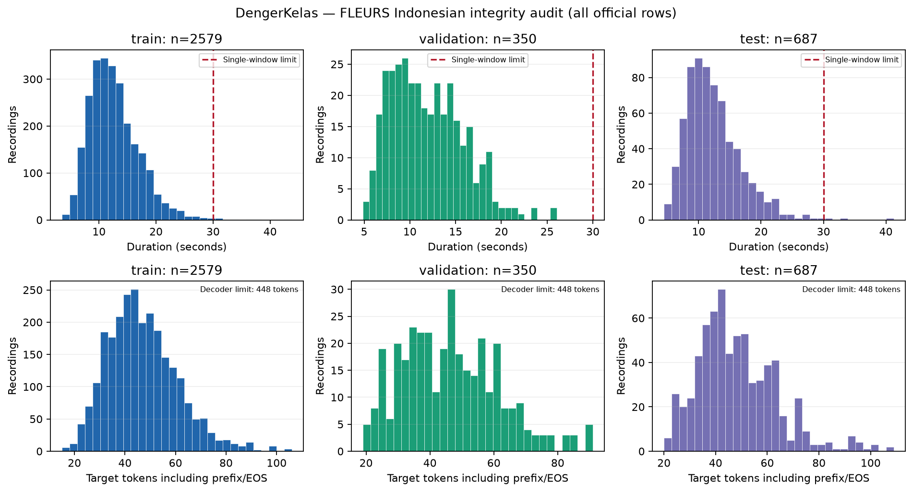

# Dataset card — DengerKelas

Status Step 3: **Selesai**, konfigurasi `step3-v2`. Dokumen faktual ini dirender oleh `python -m src.data.documentation`. Sumber angka utama: `results/step3/speech_statistics.json`; dokumen lain merujuk ke sini agar statistik tidak berbeda.

## Identitas dan cakupan

Speech: [google/fleurs](https://huggingface.co/datasets/google/fleurs), konfigurasi `id_id`, revisi `70bb2e84b976b7e960aa89f1c648e09c59f894dd`. Source `train/dev/test` dipetakan ke split resmi `train/validation/test`. Dataset adalah read speech bahasa Indonesia dengan referensi teks, bukan rekaman kelas spontan. Label task adalah transkripsi urutan token.

| Split resmi | Awal | Jam awal | Kompatibel | Jam kompatibel | Dikecualikan unik |
|---|---:|---:|---:|---:|---:|
| train | 2,579 | 9.093567 | 2,538 | 8.883717 | 41 |
| validation | 350 | 1.159200 | 345 | 1.138683 | 5 |
| test | 687 | 2.365400 | 678 | 2.312100 | 9 |

Angka dihitung dari seluruh WAV yang diunduh dan dibaca, bukan perkiraan lintas bahasa. Durasi presisi detik sebelum/sesudah tersedia di JSON sumber. Semua baris dan audio asli dipertahankan. `eligible` menandai subset yang lolos aturan kualitas/encoding dan batas masukan tunggal <=30 detik; contoh panjang dapat diperiksa dalam evaluasi streaming terpisah nanti tanpa pemotongan label sembarangan.

## Filtering dan kualitas

Alasan pengecualian per split:

- train: {"suspect_mojibake_pending_review": 34, "longer_than_single_window": 8}
- validation: {"suspect_mojibake_pending_review": 5}
- test: {"suspect_mojibake_pending_review": 6, "longer_than_single_window": 3}

Hitungan alasan dapat tumpang tindih; satu rekaman train memiliki dua alasan. Pola mojibake dipilih setelah inspeksi train/validation (misalnya `São`): pasangan karakter C2/C3 ala Latin-1 diikuti U+0080–U+00BF dikecualikan sampai diverifikasi manusia. Tidak ada perbaikan nama/label yang ditebak. Seluruh raw text dan target tetap tersimpan. Aturan sama diterapkan ke audit integritas test; tidak ada inferensi atau tuning test.

Flag lain dan flag encoding yang tercatat:

- train: {"suspect_mojibake": 34, "possible_clipping": 32}
- validation: {"suspect_mojibake": 5, "possible_clipping": 3}
- test: {"suspect_mojibake": 6, "possible_clipping": 3}

Clipping adalah indikasi numerik, tidak otomatis membuktikan audio rusak, sehingga tidak menjadi alasan penghapusan. Semua contoh telah diperiksa keterbacaan, SR/channel, NaN/Inf, kosong/energi nol, peak/RMS, durasi, panjang teks dan token. Listening review manusia belum dilakukan; audit otomatis dan token roundtrip tidak membuktikan kesesuaian semantik setiap audio dengan label.

## Identitas dan leakage

Recording ID: `fleurs:id_id:<source_split>:<filename_stem>`. Kolom sumber `id` berulang dan tidak dipakai sebagai recording ID atau speaker ID. Hash file dan decoded PCM disimpan; seluruh split resmi tetap dapat ditelusuri.

- Grup audio identik decoded PCM: 0; antarsplit: 0.
- Grup transkrip scoring berulang: 1457; antarsplit: 0.
- ID sumber yang muncul lebih dari sekali: 1457.

Teks berulang dengan waveform berbeda dipertahankan; ini dapat berupa take/pembicara berbeda tetapi tidak membuktikan identitas pembicara. Metadata speaker ID tidak tersedia. Tidak ada klaim speaker independence.

Distribusi gender sebagaimana metadata sumber (bukan identitas yang ditebak):

- train: {"MALE": 1081, "FEMALE": 1498}; 1461 ID kalimat untuk 2579 nama file unik.
- validation: {"MALE": 350}; 147 ID kalimat untuk 350 nama file unik.
- test: {"MALE": 687}; 328 ID kalimat untuk 687 nama file unik.

Validation/test berlabel MALE seluruhnya: ini keterbatasan representasi penting. Jangan mengacak ulang split resmi untuk menyembunyikannya; evaluasi independen target pengguna tetap diperlukan.

Distribusi seluruh baris resmi sebelum filtering (batas 30 detik dan batas decoder ditandai):

## Preprocessing dan fitur

Seluruh speech sumber sudah mono 16 kHz dan dipakai kembali; tidak ada salinan clean yang tidak perlu. `read_audio` menyediakan konversi stereo dan resample_poly sungguhan jika diperlukan untuk sumber lain. Tidak ada denoising/gain normalization agresif. Target training hanya Unicode NFC dan collapse whitespace; raw text serta normalized source text dipertahankan.

Aturan scoring terpisah: Unicode NFKC, casefold, tanda baca Unicode menjadi spasi, collapse whitespace; angka, kata Indonesia/nama/istilah Inggris tetap dipertahankan. Terapkan aturan yang sama ke referensi dan prediksi. Belum ada WER/CER atau inferensi model.

Processor/tokenizer multilingual Whisper Tiny revisi `169d4a4341b33bc18d8881c4b69c2e104e1cc0af` menghasilkan `float32 (80,3000)` per contoh, prefix `<|startoftranscript|> <|id|> <|transcribe|> <|notimestamps|>`, EOS asli dipertahankan, padding label -100, dan decoder-start dibuang satu kali pada batch label. Batas decoder aktual 448 token; fitur dihitung on-the-fly, tidak disimpan seluruhnya sebagai cache berpadded.

## Noise dan penggunaan yang sesuai

| Peran | Lingkungan | Channel | Sample rate | Sample aktual | Detik aktual |
|---|---|---:|---:|---:|---:|
| train | OOFFICE | 1 | 16000 | 4800064 | 300.004 |
| validation | OHALLWAY | 1 | 16000 | 4800064 | 300.004 |
| test | PCAFETER | 1 | 16000 | 4800064 | 300.004 |

Hanya channel 1 diekstraksi; semua 16 channel setiap arsip tercatat berada dalam peran lingkungan yang sama. Noise tidak memiliki target transkripsi utama: target tetap speech FLEURS. Campuran adalah kondisi terkontrol, bukan bukti rekaman kelas nyata.

Data ini mendukung baseline B/E1 clean serta E2 noisy dan clean/noisy evaluation terkontrol. Read speech, kalimat berulang, bias gender, domain/aksen, dan background noise dari lingkungan berbeda membatasi generalisasi ke kelas BINUS. Dataset publik tidak menggantikan minimal lima pengguna nyata. Lihat [sumber/lisensi](DATA_SOURCES_AND_LICENSES.md) dan [prosedur/hasil](STEP3_DATA_PREPARATION.md).
